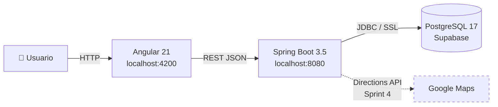
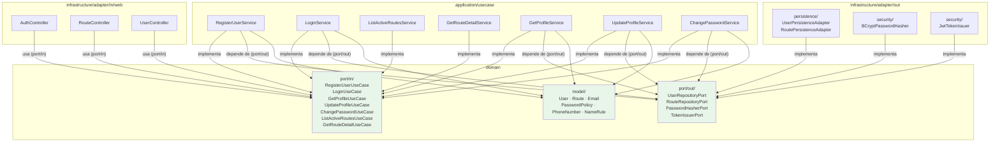
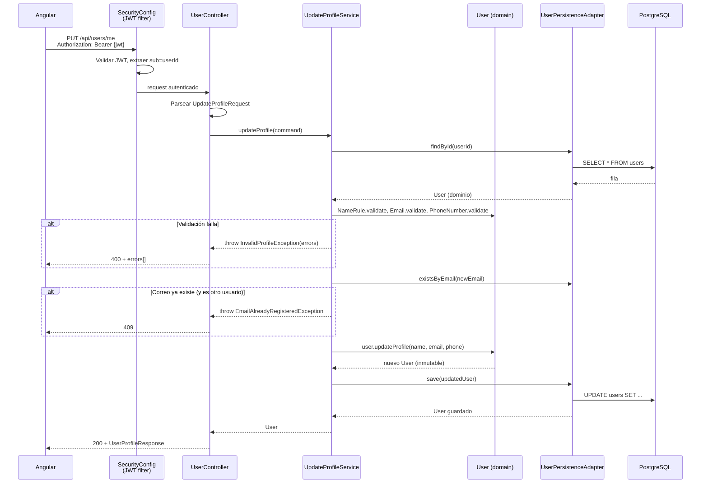

# FusaRoute Backend

[](https://sonarcloud.io/summary/new_code?id=sabego2006_FusaRoute-BACKEND)

API REST para el sistema de información de transporte público de Fusagasugá.
Arquitectura hexagonal (puertos y adaptadores), Java 25, Spring Boot 3.5, PostgreSQL en Supabase.

> El badge apunta a SonarCloud (SCRUM-181); el análisis corre en el CI en cada PR y push a
> `main`. Ver `docs/calidad/sonarqube.md`.

## Cómo correr

**Requisitos:** JDK 25 y Maven 3.9+. No requiere PostgreSQL local — DEV apunta al
proyecto Supabase compartido `fusaroute-dev`.

```bash
cp .env.example .env
# Llenar .env con las credenciales (ver .env.example para cada variable).
# JWT_SECRET es obligatorio: genéralo con  openssl rand -base64 32
# CORS_ALLOWED_ORIGINS: dejar COMENTADA si usas el default (localhost:4200,8081).
#   Una línea presente pero vacía rompe CORS.
mvn spring-boot:run -Dspring-boot.run.profiles=dev
# Comprobar: GET http://localhost:8080/health  →  {"status":"UP"}
```

## Despliegue (PROD)

| Pieza | Dónde | Configuración versionada |
|---|---|---|
| Backend | Render, tier gratis, región Virginia, contenedor Docker | `Dockerfile`, `render.yaml` |
| Base de datos | Supabase `fusaroute-prod` (us-east-1), rol `fusaroute_prod`, esquema `fusaroute` | `db/migration/` (Flyway migra al arrancar) |
| Frontend | Vercel | repo `FusaRoute-FRONTEND` |

- **Render despliega solo commits de `main` con el CI en verde** (`autoDeployTrigger: checksPass`).
  La imagen no corre tests: la compuerta es el CI.
- **Variables:** las de `render.yaml` con `sync: false` se llenan en el dashboard de Render
  y nunca en el repo. `SPRING_PROFILE=prod`.
- **Conexión a Supabase por el session pooler**
  (`jdbc:postgresql://aws-0-us-east-1.pooler.supabase.com:5432/postgres?sslmode=require`,
  usuario `fusaroute_prod.<project-ref>`). El host directo es solo IPv6 y Render no sale
  por IPv6; el puerto 6543 rompe los prepared statements de Hibernate.
- **`CORS_ALLOWED_ORIGINS`** = URL exacta del frontend en Vercel. Sin la variable, el
  arranque falla (a propósito); presente pero vacía, el navegador bloquea todas las
  llamadas. Las URL de preview de Vercel no están permitidas.
- **Cold start:** la instancia gratis se duerme tras 15 min sin tráfico. Ver RNF-02.

## Arquitectura

### Contexto general



### Hexágono: capas y su mapeo al código



> La dependencia siempre apunta hacia adentro: `domain` no importa Spring, JPA ni Jackson.
> ArchUnit lo verifica en cada build.

### Secuencia: PUT /api/users/me (actualizar perfil)



## API

### Tabla de endpoints

| Método | Ruta | Auth | Código(s) | Descripción |
|--------|------|------|-----------|-------------|
| `GET` | `/health` | No | 200 | Estado del servicio |
| `POST` | `/api/auth/register` | No | 201 / 400 / 409 | Registro de usuario |
| `POST` | `/api/auth/login` | No | 200 / 401 | Inicio de sesión (JWT) |
| `GET` | `/api/routes` | No | 200 | Catálogo de rutas activas |
| `GET` | `/api/routes/{id}` | No | 200 / 404 | Detalle de una ruta |
| `GET` | `/api/routes/{id}/fare` | No | 200 / 404 | Costo del pasaje de una ruta (RF-06) |
| `GET` | `/api/users/me` | Sí | 200 / 401 | Perfil del usuario autenticado |
| `PUT` | `/api/users/me` | Sí | 200 / 400 / 401 / 409 | Actualizar perfil |
| `PUT` | `/api/users/me/password` | Sí | 204 / 400 / 401 | Cambiar contraseña |
| `GET` | `/api/users/me/totp` | Sí | 200 / 401 | Estado del segundo factor (SCRUM-179) |
| `POST` | `/api/users/me/totp/enroll` | Sí\* | 200 / 401 / 409 | Inicia el enrolamiento: secreto, `otpauth://` y QR |
| `POST` | `/api/users/me/totp/confirm` | Sí\* | 200 / 401 / 409 | Activa el factor, devuelve JWT completo y códigos de respaldo |
| `POST` | `/api/users/me/totp/recovery-codes` | Sí | 200 / 401 / 409 | Regenera los 10 códigos de respaldo |
| `GET` | `/api/users/me/history` | Sí | 200 / 401 | Últimas 6 búsquedas del usuario (RF-07, SCRUM-20) |
| `GET` | `/api/users/me/favorite-destination` | Sí | 200 / 204 / 401 | Destino favorito, con su aviso de congestión (RF-10, SCRUM-21) |
| `PUT` | `/api/users/me/favorite-destination` | Sí | 200 / 400 / 401 | Marcar favorito, reemplazando el anterior (RF-10) |
| `DELETE` | `/api/users/me/favorite-destination` | Sí | 204 / 401 | Quitar el favorito (RF-10) |
| `POST` | `/api/comments` | Sí | 201 / 400 / 401 | Dejar un comentario (RF-08, SCRUM-22) |
| `GET` | `/api/comments/me` | Sí | 200 / 401 | Mis comentarios con estado y respuesta (RF-08) |
| `PUT` | `/api/comments/{id}` | Sí | 200 / 400 / 401 / 404 / 409 | Editar mi comentario, solo si sigue pendiente (RF-08) |
| `DELETE` | `/api/comments/{id}` | Sí | 204 / 401 / 404 / 409 | Borrar mi comentario, solo si sigue pendiente (RF-08) |
| `GET` | `/api/comments/me/unread-count` | Sí | 200 / 401 | Respuestas nuevas desde el ingreso anterior (RF-14, SCRUM-101) |

\* Estos dos aceptan el JWT completo o el **token de enrolamiento** de vida corta
(claim `scope=totp_enroll`). Todo lo demás exige `scope=full`.
| `GET` | `/actuator/health` | No | 200 | Estado del servicio y sus dependencias (RNF-01/02) |
| `GET` | `/actuator/prometheus` | Sí | 200 / 401 | Métricas en formato Prometheus (RNF-01) |
| `GET` | `/api/_internal/maps-probe` | Sí | 200 / 401 / 503 | Probe de diagnóstico de RNF-01 (solo si está habilitado, ver abajo) |

### Contrato de error (ProblemDetail, RFC 9457)

Todos los errores devuelven un cuerpo JSON con al menos `status` y `detail`:

```json
{ "type": "about:blank", "title": "Bad Request", "status": 400, "detail": "Datos de registro invalidos",
  "errors": [{ "field": "password", "message": "La contrasena debe incluir al menos un numero" }] }
```

- `errors` solo aparece en `400` de validación (registro, perfil, contraseña).
- `401` sin token o con token inválido: `detail` = "Autenticacion requerida".
- `401` en login: `detail` = "Correo o contrasena incorrectos".
- `409`: `detail` = "Ya existe una cuenta con ese correo".
- `404`: `detail` = "Ruta no encontrada" / "El usuario no fue encontrado".
- `415`, `405`: el código HTTP correcto (no 500), con `detail` descriptivo.

### `POST /api/auth/register` — Registro de usuario (RF-01, SCRUM-12)

Endpoint público (no requiere token). Crea un usuario con rol `USER`, activado de
inmediato (sin verificación por correo este semestre).

**Request** (`application/json`):

```json
{ "name": "Ana Pérez", "email": "ana@ejemplo.com", "password": "Clave123" }
```

- `name`: obligatorio, máximo 120 caracteres.
- `email`: obligatorio, formato válido, único; se normaliza (trim + minúsculas).
- `password`: mínimo 8 caracteres, al menos 1 mayúscula y 1 número, máximo 72 bytes UTF-8.
- El teléfono no se envía en el registro; se edita luego en el perfil (RF-03).

**`201 Created`** — nunca incluye el hash de la contraseña:

```json
{ "id": 1, "name": "Ana Pérez", "email": "ana@ejemplo.com", "role": "USER", "active": true }
```

**Errores** (cuerpo `ProblemDetail`, RFC 9457):

- **`400`** validación. Reúne todos los incumplimientos en la propiedad `errors`:

  ```json
  { "status": 400, "detail": "Datos de registro invalidos",
    "errors": [ { "field": "password", "message": "La contrasena debe incluir al menos un numero" } ] }
  ```

  Un JSON malformado también da `400`, con `detail` genérico y sin `errors`.

- **`409`** el correo ya tiene cuenta: `detail` = "Ya existe una cuenta con ese correo".

### `POST /api/auth/login` — Inicio de sesión (RF-02, SCRUM-13)

Endpoint público (no requiere token). Autentica con correo y contraseña y emite un
JWT (HS256) con validez de **una semana** (RNF-04); vencido, el usuario vuelve a
loguearse.

**Request** (`application/json`):

```json
{ "email": "ana@ejemplo.com", "password": "Clave123" }
```

El correo se normaliza (trim + minúsculas) igual que en el registro.

**`200 OK`** — nunca incluye el hash de la contraseña:

```json
{ "token": "eyJhbGciOi...", "tokenType": "Bearer", "expiresAt": "2026-10-05T12:00:00Z",
  "user": { "id": 1, "name": "Ana Pérez", "email": "ana@ejemplo.com", "role": "USER", "active": true } }
```

El token lleva el id del usuario en `sub` y el rol en `role`. El frontend lo guarda y lo
envía en cada petición autenticada:

```
Authorization: Bearer eyJhbGciOi...
```

El cuerpo acepta además un `totpCode` opcional, que se exige cuando el usuario ya tiene el
segundo factor activo (ver abajo). El mismo campo admite un código TOTP de 6 dígitos o un
código de respaldo.

**Errores** (cuerpo `ProblemDetail`, RFC 9457):

- **`401`** credenciales incorrectas: `detail` = "Correo o contrasena incorrectos". Es el
  **mismo mensaje** para correo inexistente, contraseña incorrecta, cuenta inactiva y
  formato de correo inválido, para no revelar qué correos tienen cuenta.
- **`401`** con `error: "TOTP_ENROLLMENT_REQUIRED"`: la contraseña es correcta pero el
  usuario aún no enroló su app autenticadora. El cuerpo trae `enrollmentToken` y
  `expiresAt`; el frontend arranca con él el enrolamiento forzado.
- **`401`** con `error: "TOTP_REQUIRED"`: falta el `totpCode`. El frontend muestra el paso 2.
- **`401`** con `error: "INVALID_TOTP"`: el código no es válido ni como TOTP ni como
  respaldo. Cuenta como intento fallido (SCRUM-36).

Cualquier otro endpoint (salvo `/health`, el registro, el login y el catálogo público de
rutas) responde **`401`** sin token, o con un token inválido o vencido.

Fuera de este sprint: el contador de intentos fallidos y el bloqueo temporal (SCRUM-155,
Sprint 3), y no hay logout ni revocación: un token es válido hasta que vence.

**Configuración:** requiere la variable `JWT_SECRET` (Base64, mínimo 32 bytes decodificados);
sin ella, o si es débil, la aplicación no arranca. Genérala con `openssl rand -base64 32`.

### Segundo factor TOTP (SCRUM-179) — obligatorio

No hay forma de entrar a la API sin segundo factor. Vale cualquier app autenticadora
estándar (Microsoft Authenticator, Google Authenticator): SHA1, 6 dígitos, periodo de 30 s,
con tolerancia de una ventana (±30 s) para la deriva de reloj.

**Usuarios existentes y nuevos pasan por el mismo camino.** La migración `V8` deja
`totp_enabled = FALSE` para todas las filas previas, así que en su siguiente login caen en
la rama de enrolamiento forzado igual que un registro nuevo.

Flujo completo:

1. `POST /api/auth/login` con correo y contraseña → **`401 TOTP_ENROLLMENT_REQUIRED`** con
   `enrollmentToken` (10 minutos, `scope=totp_enroll`, solo abre los dos endpoints de
   enrolamiento; un token robado ahí no lee el perfil ni nada más).
2. `POST /api/users/me/totp/enroll` con ese token → `secret` (para escribirlo a mano),
   `otpauthUri` (deep link en móvil) y `qrPngBase64` (el QR ya dibujado, para pintarlo en un
   `` sin librerías de QR en el frontend).
3. `POST /api/users/me/totp/confirm` con el primer código → **activa el factor y deja
   logueado**: devuelve el JWT completo de 7 días y los **10 códigos de respaldo en claro**,
   que se muestran una sola vez.
4. En los logins siguientes, `login` sin código responde `401 TOTP_REQUIRED` y con código
   válido responde `200`.

**Códigos de respaldo.** Diez, de un solo uso, guardados con BCrypt. Son la única salida si
el usuario pierde el teléfono, porque la recuperación de contraseña por correo está fuera de
alcance. Se pueden reemplazar en cualquier momento con
`POST /api/users/me/totp/recovery-codes` (exige `scope=full`): el conjunto anterior deja de
servir. **Límite conocido:** quien pierda el teléfono *y* los diez códigos queda fuera — no
hay reset administrativo.

**Cambio de teléfono.** `POST /enroll` con el **JWT completo** apaga el factor anterior y
arranca uno nuevo; con el token de enrolamiento responde `409`, para que un token corto aún
vigente no pueda borrar un factor recién confirmado.

**En reposo** el secreto se guarda cifrado con AES-256-GCM (`AesGcmSecretCipher`), nunca en
claro; el dominio lo maneja descifrado en memoria y el cifrado es responsabilidad del
adaptador de persistencia.

**Configuración:**

- `TOTP_ENCRYPTION_KEY` — Base64 de al menos 32 bytes (`openssl rand -base64 32`). **Sin
  valor por defecto: si falta, la aplicación no arranca.** Usa una distinta por ambiente;
  cambiarla deja ilegibles los secretos ya guardados.
- `TOTP_ISSUER` — el nombre que el usuario ve en su app autenticadora. Por defecto
  `FusaRoute`.

### `GET /api/routes` y `GET /api/routes/{id}` — Catálogo público de rutas (RF-15, SCRUM-19)

Endpoints públicos (sin token ni sesión), de solo lectura. Cualquier otro método sobre
`/api/routes` sigue exigiendo autenticación.

**`GET /api/routes`** — `200 OK`. Solo rutas **activas** (las suspendidas no aparecen),
ordenadas por nombre. Sin rutas activas devuelve `[]`.

**`GET /api/routes/{id}`** — `200 OK` con una sola ruta. Lleva lo mismo que una fila del
listado más tres campos que solo necesita la pantalla que abre la ruta: `lastUpdatedAt`,
`path` y `congestionSectors`.

```json
{
  "id": 8,
  "name": "Fusagasugá - Pasca",
  "type": "INTERMUNICIPAL",
  "neighborhoods": ["Fusagasugá", "Corregimiento", "Alaska", "Pasca"],
  "fares": [
    { "referencePoint": "Alaska", "amount": 3550.00, "validFrom": "2026-02-05" },
    { "referencePoint": "Pasca", "amount": 4300.00, "validFrom": "2025-01-16" }
  ],
  "lastUpdatedAt": "2026-02-05"
}
```

El ejemplo omite `path` y `congestionSectors` para abreviar.

- `lastUpdatedAt`: el `validFrom` más reciente entre las `fares` vigentes (RF-06); `null`
  si la ruta no tiene ninguna. En una intermunicipal es la fecha del precio que cambió más
  recientemente, no la de todos: cada fila trae la suya.
- `path`: trazado como `LineString` de GeoJSON; `null` si la ruta aún no lo tiene cargado.
- `congestionSectors`: sectores que la ruta atraviesa y están en su franja de trancón en
  este momento (RF-09); lista vacía si ninguno.
- El listado **no** trae ninguno de los tres: la tarjeta muestra un solo precio y no dibuja
  mapas.

- `type`: `URBANA` o `INTERMUNICIPAL`.
- `neighborhoods`: barrios en orden de recorrido. Son nombres, no paradas: en Fusagasugá se
  para la buseta con la mano.
- `fares`: solo las tarifas **vigentes**. Por cada `referencePoint` se toma la fila con el
  `validFrom` más reciente que no sea futuro; una tarifa anunciada para después de hoy no
  aparece todavía. Van de menor a mayor `amount`.
  - Ruta urbana: una sola tarifa con `referencePoint: null`.
  - Ruta intermunicipal: una tarifa por punto de referencia de bajada.
  - `validFrom` es la fecha de la última actualización de ese precio; puede ser de años
    distintos dentro de una misma ruta (ver V3).
- "Hoy" se calcula en la zona `America/Bogota`.

**Errores** (cuerpo `ProblemDetail`, RFC 9457):

- **`404`** la ruta no existe **o está suspendida** (`detail` = "Ruta no encontrada"): el
  catálogo público no revela que existe una ruta suspendida.
- **`400`** el `id` no es numérico (`/api/routes/abc`).

### `GET /api/routes/{id}/fare` — Costo del pasaje (RF-06, SCRUM-17)

Endpoint público, de solo lectura. Devuelve únicamente el pasaje de la ruta: sus tarifas
vigentes y la fecha de la última actualización. Las reglas de vigencia y de orden de
`fares` son las del detalle, arriba.

**`200 OK`** — ruta intermunicipal Fusagasugá - Pasca (`id` 8):

```json
{
  "id": 8,
  "name": "Fusagasugá - Pasca",
  "type": "INTERMUNICIPAL",
  "fares": [
    { "referencePoint": "Corregimiento", "amount": 3000.00, "validFrom": "2025-01-16" },
    { "referencePoint": "Hogar Francisco y Clara", "amount": 3000.00, "validFrom": "2025-01-16" },
    { "referencePoint": "Escuela de los Sauces", "amount": 3000.00, "validFrom": "2025-01-16" },
    { "referencePoint": "Buenas Tardes", "amount": 3300.00, "validFrom": "2025-01-16" },
    { "referencePoint": "Crucero La Angostura", "amount": 3300.00, "validFrom": "2025-01-16" },
    { "referencePoint": "Alaska", "amount": 3550.00, "validFrom": "2026-02-05" },
    { "referencePoint": "La Capilla", "amount": 3600.00, "validFrom": "2025-01-16" },
    { "referencePoint": "Pasca", "amount": 4300.00, "validFrom": "2025-01-16" }
  ],
  "lastUpdatedAt": "2026-02-05"
}
```

- Ruta urbana: una sola tarifa con `referencePoint: null`.
- `lastUpdatedAt` es `null` si la ruta no tiene ninguna tarifa vigente.

**Errores** (cuerpo `ProblemDetail`, RFC 9457):

- **`404`** la ruta no existe o está suspendida (`detail` = "Ruta no encontrada").
- **`400`** el `id` no es numérico.

**La pantalla de detalle no llama a este endpoint**: consume `GET /api/routes/{id}`, que ya
trae `fares` y `lastUpdatedAt`, para quedarse en una sola petición (LCP < 2.5 s). Este existe
como superficie de API de RF-06 y para clientes que solo quieran la tarifa.

### Caja de comentarios (RF-08, SCRUM-22)

Todos los endpoints exigen sesión. El id del autor **sale del claim `sub` del JWT**, nunca
del cuerpo ni de la URL: si viniera de ahí, cualquiera podría leer o borrar los comentarios
de otro cambiando un número.

La ruta es `/api/comments` aunque el modelo de dominio se llame `Feedback`. No es un
descuido: el nombre del modelo lo fija el `CLAUDE.md` de este repo, y la URL es lenguaje de
usuario — el usuario deja "comentarios".

**`POST /api/comments`** — `201 Created`. Cuerpo: `{ "text": "..." }`. Las tres reglas del
texto viven en el dominio (`Feedback`) y el controlador no repite ninguna:

| Regla | Qué rechaza | Código |
|---|---|---|
| Longitud | menos de 10 o más de 100 caracteres, medidos **ya recortado** | `400` |
| Sin enlaces | `http://`, `https://`, `www.` y el par `dominio.tld` suelto | `400` |
| Banco de palabras | una palabra del banco, comparada en minúsculas y sin tildes | `400` |

El **nombre del autor no se recibe**: lo resuelve el backend leyendo el perfil. Es la única
forma de que "cada comentario muestra el nombre de usuario de quien lo escribió" no se pueda
falsificar desde el cliente. La respuesta lo devuelve en `authorName`, y **no** devuelve
`userId`: el id interno de la cuenta no le sirve a ninguna pantalla.

Dos decisiones del patrón de enlaces que conviene conocer antes de "mejorarlo", ambas con
test que las fija:

- la lista de dominios de primer nivel es **cerrada**, no un `letras.letras` genérico, porque
  a quien escribe se le va el espacio después del punto ("buen servicio.Gracias") y un patrón
  genérico rechazaría ese comentario perfectamente válido;
- `.es` y `.me` quedaron **fuera** de esa lista aunque sean dominios reales: los comentarios se
  escriben en español, donde "Es" y "Me" empiezan frases todo el tiempo.

El banco de palabras vive en `src/main/resources/moderation/forbidden-words.txt`, se lee una
sola vez al arrancar y se revisa en el PR. Su encabezado explica el criterio de la lista y
qué palabras quedaron fuera a propósito — "negro" aparece al describir el letrero de una
ruta y "ladrón" es el aviso más útil que la caja puede recibir. Si el archivo falta, el
filtro de palabras queda desactivado con un `WARN` en el log y el arranque **no** se rompe:
un comentario grosero lo resuelve un administrador leyendo, un backend caído se lleva también
el catálogo público.

**`GET /api/comments/me`** — `200 OK`, del más reciente al más antiguo, con `status`
(`PENDING`/`ANSWERED`), `reply` y `answeredAt`. Sin comentarios devuelve **lista vacía**, no
`404`. Cada elemento trae `editable`, calculado en el backend: el frontend no deduce la regla.
Ojo con lo que `editable` **no** es — esconder un botón no es seguridad, y el backend vuelve
a verificar la regla en cada `PUT` y `DELETE`.

**`PUT` y `DELETE /api/comments/{id}`** — solo del autor y **solo mientras esté pendiente**:

- **`404`** no existe **o es de otro usuario**. Los dos casos responden igual a propósito: un
  `403` para el comentario ajeno confirmaría que ese id existe, y con eso cualquiera puede
  recorrer ids y contar cuántos comentarios tiene el sistema.
- **`409`** ya fue respondido. `409` y no `403` porque el permiso está bien — es su
  comentario — y lo que choca es el estado del recurso. El frontend usa esa diferencia para
  recargar el comentario y mostrar la respuesta que acaba de aparecer, en vez de mandar al
  usuario a iniciar sesión.

Ese bloqueo no es cosmético: protege la métrica 4 del panel de RF-13. Si el autor pudiera
reescribir un comentario ya respondido, el conteo de pendientes dejaría de corresponder con
lo que el administrador revisó.

### Respuestas nuevas, sin notificaciones push (RF-14, SCRUM-101)

**`GET /api/comments/me/unread-count`** — `200 OK` con `{ "count": N }`. Las notificaciones
push están **fuera de alcance** este semestre, así que no hay aviso proactivo: el frontend
pregunta al cargar la sesión y pinta un contador en el ícono de comentarios.

**Cuenta contra el ingreso ANTERIOR, no contra el último**, y por eso `users` tiene dos
columnas (`last_login_at` y `previous_login_at`, V19) en vez de una. Con una sola la respuesta
sería siempre "nada": el login acaba de mover esa columna a `now()`, y el frontend consulta
justo después de iniciar sesión. El login **corre** el valor — lo que era el último pasa a
ser el anterior — y el contador compara contra el anterior.

Dos consecuencias que no son obvias:

- en el **primer** ingreso de una cuenta no hay un "antes", y el contador devuelve `0` en vez
  de contar todo su historial;
- **confirmar el segundo factor también registra un ingreso**, porque confirmar deja sesión
  abierta. Sin eso, las respuestas recibidas durante esa primera sesión de 7 días no
  aparecerían en el contador al volver a entrar.

Corregir una respuesta **mueve** `answered_at`, así que una respuesta editada vuelve a contar
como nueva. Es deliberado: si se conservara el instante original, la corrección pasaría
inadvertida para el usuario.

Para crear un administrador en DEV (hace falta para RF-14 y RF-11), ver
[`docs/datos/crear-administrador-en-dev.md`](docs/datos/crear-administrador-en-dev.md).

## Métricas y p95 (RNF-01, SCRUM-127)

El RNF-01 exige **p95 < 8 s** extremo a extremo en `/api/routes/search` y un caché de
**5 min por par origen-destino** sobre las llamadas a Google Maps. El endpoint de búsqueda
no existe todavía (depende de RF-04); lo que este sprint deja listo es el instrumento y el
adaptador, para no cablear todo de golpe cuando RF-04 aterrice.

**Acceder a las métricas** (requieren JWT, igual que cualquier endpoint protegido):

```bash
curl -H "Authorization: Bearer $TOKEN" http://localhost:8080/actuator/prometheus
curl -H "Authorization: Bearer $TOKEN" http://localhost:8080/actuator/metrics/http.server.requests
```

- `http.server.requests` trae el histograma y los percentiles (0.5, 0.95, 0.99) de **todos**
  los endpoints — ahí se leerá el p95 de `/api/routes/search` cuando exista.
- `fusaroute.maps.travel_time` (tags `status=ok|error`): latencia de la llamada **real** (sin
  caché) a la Distance Matrix API de Google.
- `fusaroute.maps.cache` (tags `result=hit|miss`): cuántas consultas de tiempo de viaje se
  resolvieron con el caché de 5 min vs. con una llamada nueva a Google.

**Caché**: bean `googleMapsTravelTime` (Caffeine, `spring.cache.caffeine.spec` en
`application.properties`), TTL 5 min, clave = par origen-destino (sin incluir el trazado: la
Distance Matrix API cotiza por par, no por ruta — seguir un trazado específico exigiría la
Roads API, fuera de alcance). Un fallo de Google nunca se cachea.

**Probe interno** (`GET /api/_internal/maps-probe?originLat=&originLon=&destLat=&destLon=`):
valida el cache y las métricas de arriba sin esperar a que `/api/routes/search` exista.
Apagado por defecto salvo en `dev` (`fusaroute.internal.maps-probe-enabled`). Responde
`X-Cache: HIT|MISS` cuando la llamada a Google tiene éxito, o `503` con el `status` real de
Google en `detail` (p. ej. `REQUEST_DENIED` si la API key no tiene Distance Matrix habilitada
en Google Cloud Console — es la situación actual en DEV y queda pendiente de que alguien con
acceso al proyecto de Maps lo habilite).

**Pendiente, a reportar ante el comité en vez de darlo por cumplido:**
- El p95 real sobre `/api/routes/search` no se puede medir hasta que RF-04 cierre.
- El cold start de Render (tier gratis, hasta 60 s tras 15 min de inactividad) puede empujar
  el p95 de la primera consulta por encima de 8 s; sigue sin decidirse si se acepta o se paga
  un tier con instancia siempre activa.
